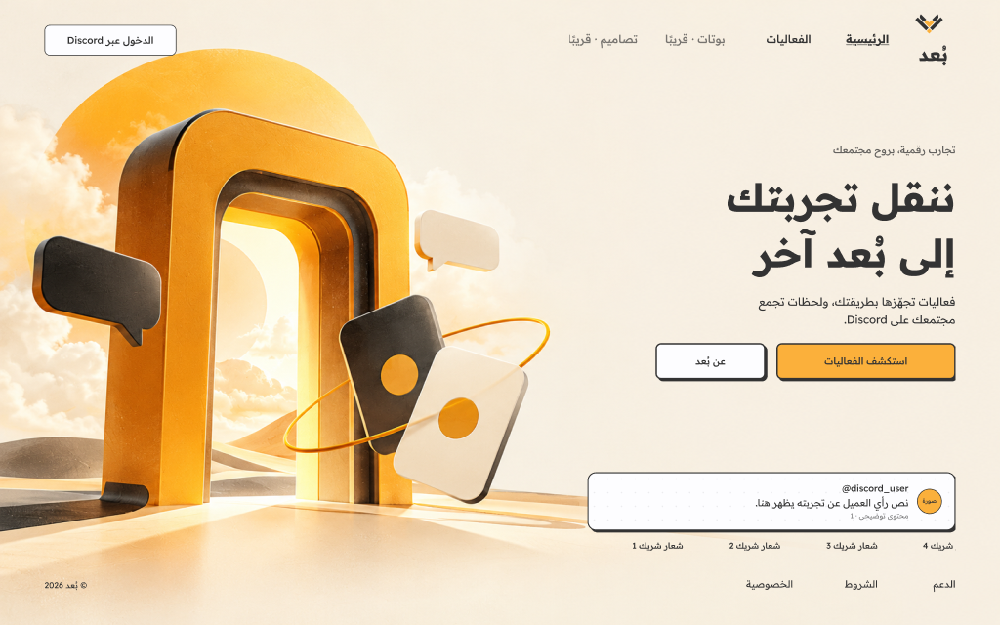
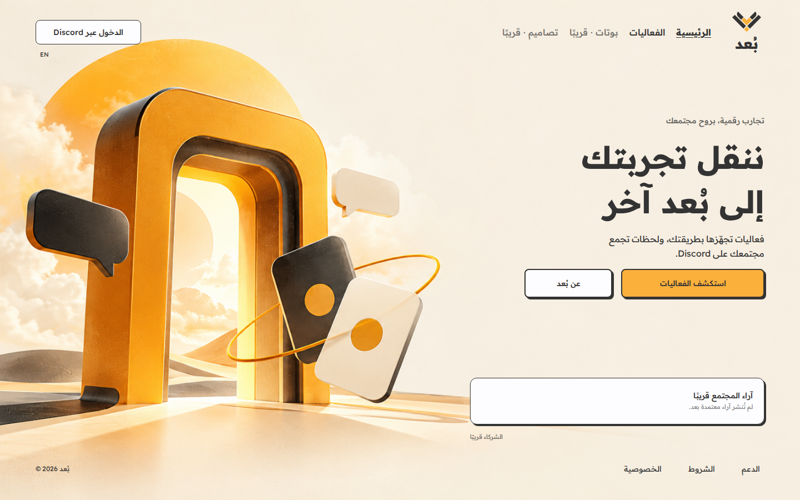
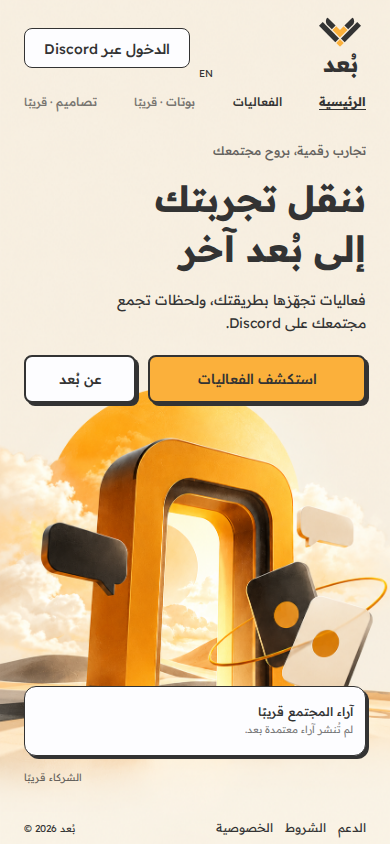

# BU'D — verified development increment, 2026-10-22

Status: actual implementation, local checks PASS; whole-platform acceptance OPEN. Current branch feat/bud-platform-production-20261022; remote commit/Preview evidence is recorded in Notion after deployment. No production merge, billing or paid resource.

## What runs

- Figma-based public Home and Events/Bots/Designs navigation; reusable product details modal. Desktop/mobile original portal rasters match Figma image hashes. Current samples are honest empty review/partner states, not endorsements.
- Local Question & Condition rehearsal: setup→live→prizes→closing; independent card flip, optional3–30s timer after both cards, Correct→winner name, one award per winner, manual names only; no participant route or bot.
- Server-side Discord-user authorization and owned Slot start/resume/balance contract; checkout and webhook fail closed. No pretend OAuth/payment success.
- Additive sandbox schema/migration and actual SQL tests. Dedicated live provider configuration and connected flow remain blockers.

## Checks executed on this source tree

| Check | Result | Scope |
|---|---|---|
| npm run build | PASS | TypeScript client and Vite production bundle |
| npm run typecheck:server | PASS | API/server entrypoints, pinned TS7 command |
| node unit/SQL tests via npm test |36/36 PASS, zero skips | Includes preserved historical reducer regression,7 new manual-game tests,6 server tests, actual disposable PGlite SQL. Historical participant reducer is unreferenced by new product routes. |
| Playwright production.spec.ts |15/15 PASS | AR/EN ×1440×900,1366×768,390×844,375×667,360×800; product modal Tab8cycles/ShiftTab/Escape/return focus; full manual prize/closing flow both locales; reduced motion; legacyPreview cannot expose participants; unavailable buy state; short-screen game geometry. |
| git diff --check | PASS | Tracked patch whitespace |

Local Chromium153 binary was retrieved through the reputable @sparticuz/chromium npm package as a temporary QA dependency; it is not a product dependency. Standard Playwright browser download failed in this host. CI uses pinned Playwright1.64/its own installed Chromium, so CI evidence must be checked independently on the exact remote SHA. No local result is presented as remote Preview or CI success.

Independent separate-agent review (same model, not human certification) found and root fixed: timer deadline lost when visiting prizes, deadline lost after Correct→Cancel, removed-trigger focus restoration, URL locale split. Root browser QA also fixed a shared CSS class collision overriding game min-height, modal focus cycling and early close behavior. Regression cases added and rerun.

## Visual evidence

| Target | Figma | Implementation |
|---|---|---|
| Desktop Home |  |  |
| Mobile Home |  |  |

Additional current Product Modal/game/closing screenshots and SHA256 manifest are in evidence/. Screenshots were captured after fonts and finite animations were completed; source screenshots never act as product assets.

## Open blockers; no stage closure

- Original dotted texture unavailable because asset URLs returned HTML and Figma seat quota stopped native retrieval; do not redraw/substitute silently.
- Immutable latest Figma approval/version receipt not exposed; exact observed node IDs and image hashes recorded. Modal/Bots/Designs empty-state styling, English copy and content bank remain reviewable implementation choices, not claimed approved designs.
- Discord provider disabled; no Vercel env configuration; allowlist unverified. No reviewed Whop verifier/product mapping or true connected sandbox purchase.
- Local SQL serial connection does not prove multi-connection PostgreSQL races. Live tenant/concurrency/webhook tests required before commerce acceptance.
- Pricing, Slot expiry, retention, historical event clock/restart/grace carryover, duplicate/edit policy, final legal/support text unresolved.
- Full performance budget/load tests, field trial and owner visual acceptance are incomplete. No fabricated Lighthouse or accessibility score.
- Gate00 and project S05/S06/S07+ remain OPEN/IN PROGRESS/BLOCKED as applicable. Notion formulas report evidence readiness; they do not prevent arbitrary manual status edits.
